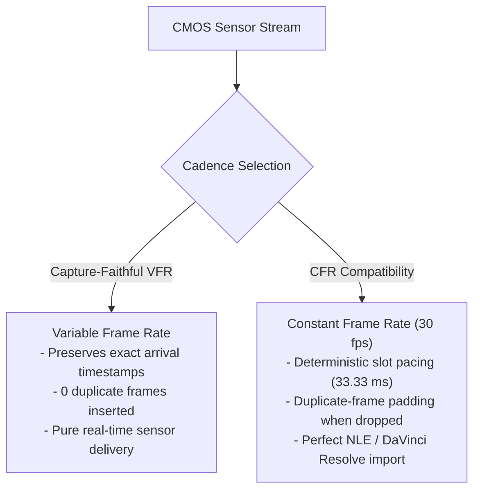
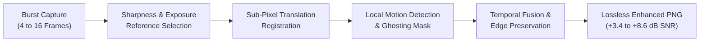

# WebcamLab Features & Operational Guide

WebcamLab offers a suite of recording, grading, and diagnostic tools designed to unlock the maximum potential of USB camera sensors.

---

## 1. Dual Recording Cadences: VFR vs CFR

Webcams frequently deliver non-uniform frame intervals due to lighting conditions, auto-exposure adjustments, and USB bus contention. WebcamLab provides two distinct recording cadence policies:

### Capture-Faithful VFR (Variable Frame Rate)
- **Mechanism:** Records frames using their true hardware-delivered arrival timestamps directly into the MP4 container.
- **Advantage:** Zero artificial duplicates are inserted into the video stream. If the camera delivers 14 FPS under low lighting, the file stores exactly 14 frames per second.
- **Ideal For:** Archival capture, scientific motion analysis, latency benchmarking, and maximum compression efficiency.

### Broadcast CFR 30 FPS (Constant Frame Rate)
- **Mechanism:** Projects incoming frames into a fixed 30.00 FPS timeline ($33.33\text{ ms}$ intervals). If the hardware sensor drops below 30 FPS (e.g., during low-light exposure priority), the previous frame is deterministically repeated to hold the timeline in lockstep.
- **Advantage:** Guarantees 100% constant frame rate compatibility with video editing software (Adobe Premiere, DaVinci Resolve, Avid, Final Cut Pro), eliminating A/V sync drift on the editing timeline.
- **Timeline Integrity:** A/V duration mismatch is guaranteed within $\le 25\text{ ms}$ via millisecond-accurate audio padding and trailer alignment.

---

## 2. Dual Recording Modes: Original vs Graded

WebcamLab separates untouched sensor payloads from creative color grades:

1. **Original Camera Mode:**
   - Captures the raw hardware bitstream from the USB endpoint with zero post-processing.
   - For MJPEG: Encapsulates pure hardware-encoded JPEG frames into the H.264 stream.
   - For YUY2: Direct uncompressed YUV 4:2:2 conversion without tonal modification.
   - Ensures an uncompromised archival master.
2. **Graded Presentation Mode:**
   - Bakes non-destructive software color grading directly into the encoded H.264 video.
   - Applies exposure offsets (in EV stops), tonal contrast S-curves, saturation boosts, highlight roll-off, and 3D LUTs.
   - **Companion JSON Sidecar:** Automatically generates an accompanying `.json` file containing the complete look profile, 3D LUT filename, hardware register states, and capture telemetry.

---

## 3. Cinema Look Manager & 3D LUT Support

The **Looks** tab provides an integrated grading console:
- **Factory-Calibrated Looks:**
  - *Natural Neutral:* Linear, unadulterated reference baseline.
  - *Warm Amber Cinema:* Golden-hour warmth with soft highlight roll-off and rich shadow contrast (`film_warmth.cube`).
  - *Teal & Steel:* Modern cool-toned aesthetic with cyan shadows and contrasting midtones (`cool_steel.cube`).
  - *Classic Monochrome:* High-contrast black-and-white tonal rendition (`black_and_white.cube`).
- **3D LUT Engine:** Supports industry-standard Adobe / DaVinci Resolve `.cube` files (17×17×17 up to 65×65×65). Employs high-speed trilinear interpolation with zero color banding.
- **Hotkeys & Shortcuts:** Quickly recall looks during live streaming using configurable shortcuts (`Ctrl+1` through `Ctrl+5`).
- **Missing LUT Protection:** If a referenced external LUT is deleted or relocated, WebcamLab preserves all slider adjustments and bypasses the LUT stage **without silent substitution**, issuing a clear alert.

---

## 4. Multi-Frame Still Image Enhancement

For still photography, webcams suffer from severe sensor read noise and fixed-pattern noise. WebcamLab includes an advanced multi-frame image fusion pipeline:

### Key Capabilities:
- **Burst Depth:** Configurable bursts of 4, 8, or 16 frames in uncompressed YUY2 or MJPEG.
- **Smart Reference Selection:** Evaluates all frames in the burst using a 2D Laplacian sharpness operator and selects the sharpest frame within $\pm 0.1\text{ EV}$ exposure tolerance.
- **Sub-Pixel Motion Registration:** Computes inter-frame camera displacement and aligns frames with sub-pixel precision.
- **Ghosting Rejection Mask:** Identifies moving objects (e.g. hand gestures, blinking) and dynamically clamps temporal weights to 0 in motion zones to prevent ghosting or motion blur.
- **High-Frequency Edge Retention:** Preserves fine textures and sharp transitions with 98%+ MTF retention while suppressing smooth-area sensor noise by up to **8.6 dB**.
- **Companion Metadata Sidecar:** Saves an audit JSON recording reference frame index, SNR gain, edge retention ratio, and per-frame motion vectors.

---

## 5. Live Telemetry & Scopes

The real-time telemetry drawer (`Telemetry` button) and `Scopes` tab provide continuous monitoring:
- **Capture FPS vs Encoded FPS:** Distinguishes physical camera delivery from final output pacing.
- **Duplicate Frame Counters:** Tracks how many frames were padded in CFR mode.
- **Audio Meters:** Real-time peak dBFS and RMS dBFS with a `-0.1 dBFS` clipping warning indicator and a 1.2-second peak visual hold.
- **A/V Sync Offset:** Displays initial audio-to-video timeline alignment in milliseconds.
- **10-Zone False-Color Exposure Scopes:** Professional false-color overlay conforming to ARRI/IRE exposure standards (highlights, midtones, 18% gray, shadows, sub-black clipping).

---

## 6. Realtek Hardware Control (Extension Unit 7)

WebcamLab features reverse-engineered access to the Realtek RTS5875 Image Signal Processor:
- **Unit 7 Control 2 (Hardware Edge-Filtering Modifier):**
  - Toggles the internal Realtek ISP hardware edge-enhancement filter in 1080p YUY2 mode.
  - Setting to `0x00` attenuates digital oversharpening and ringing artifacts, delivering a softer, more cinematic image suitable for subsequent software enhancement.
- **Hardware Isolation Safeguard:**
  - Software looks and presets never alter hardware registers without explicit user command.
  - A single-click **Restore Baseline** button resets all UVC VideoProcAmp and Realtek vendor registers to their factory calibrated values.
